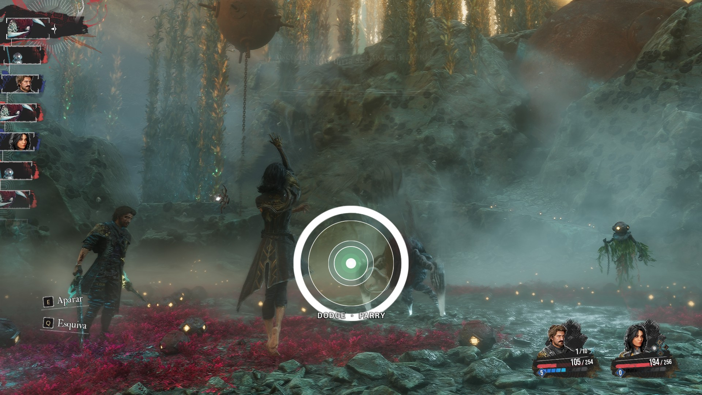
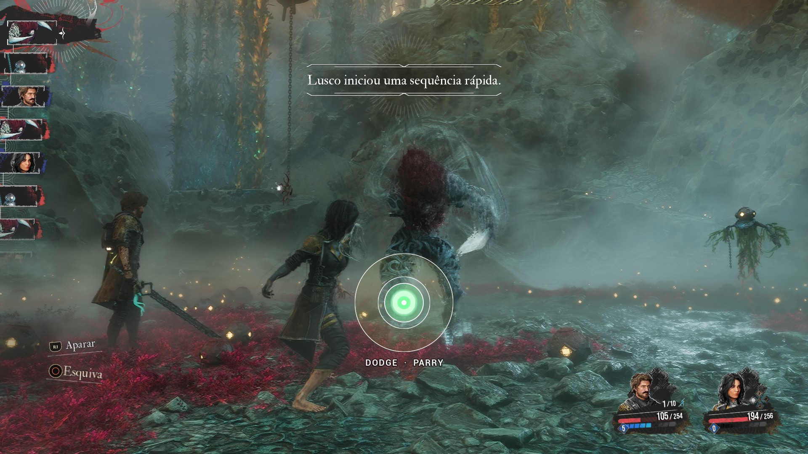
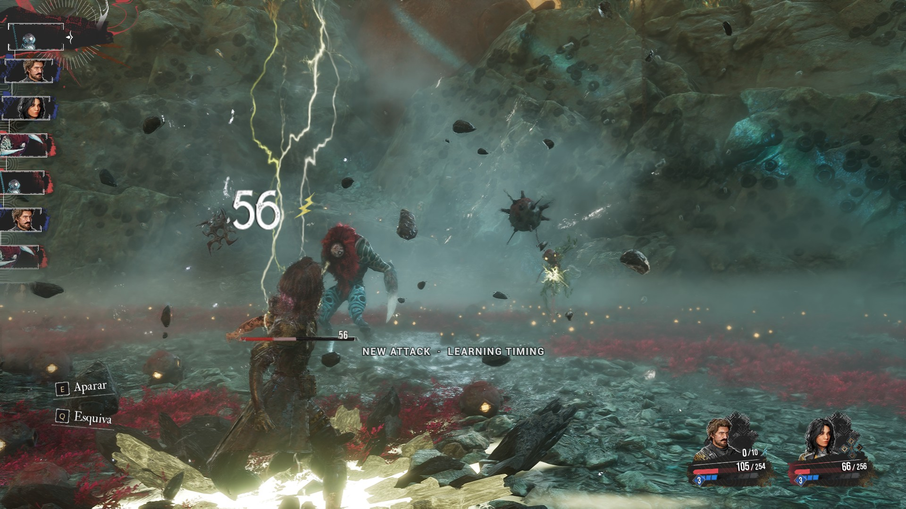

# Riposte

**A timing circle for every enemy hit in Clair Obscur: Expedition 33, plus a grace period that turns near-miss dodges and parries into reduced damage instead of a full hit.**

UE4SS Lua mod · no game files changed · MIT License

| The ring closes in on the hit | Inside the perfect window |
|---|---|
|  |  |

## Features

### Timing circle
For every upcoming enemy hit, a ring shrinks onto a dot and touches it at the moment the hit lands. The discs behind it are the **real windows of the character being attacked**, drawn at the same scale.

| Colour | Meaning |
|---|---|
| 🟢 Green | parry window |
| 🔵 Blue | dodge window |
| 🟡 Yellow | grace window (reduced damage) |
| 🟠 Orange | jump attack |
| 🟣 Purple | gradient attack |

**Press while the ring is inside the disc of the move you want.** The label under the circle names the move the attack asks for.

### Grace period
In vanilla, a dodge or parry either cancels the hit or does nothing. Riposte adds a window around the game's own:

| You pressed | Result |
|---|---|
| inside the game's window | unchanged: no damage, counters and rewards as usual |
| up to 0.25 s too early | the hit is reduced before it is applied |
| up to 0.20 s too late | the reduced share is handed back as HP |
| further out | full damage |

The reduction is 90 % at the edge of the game's window and falls in a straight line to 0 % at the far edge. A near miss never triggers a counter. Jumps only count against jump attacks and gradient parries only against gradient attacks, as in vanilla. Buff and Lumina damage are never touched.

## Install

1. Install [RE-UE4SS](https://github.com/UE4SS-RE/RE-UE4SS/releases) **3.0.1 or newer** into `Expedition 33\Sandfall\Binaries\Win64\`.
2. Extract `Riposte-<version>.zip` into the game folder `Expedition 33\`.
3. Start the game. `ue4ss\UE4SS.log` should contain `[Riposte] v... loaded`.

**Linux / Steam Deck:** add the launch option `WINEDLLOVERRIDES="dwmapi=n,b" %command%`.
**Don't** run it together with Graded Defense: both would reduce the same hits.

Optional presets (`Riposte-Preset-*.zip`) only replace `riposte_config.lua`:

| Preset | Settings |
|---|---|
| Standard (main file) | early 0.25 s, late 0.20 s, max 90 % |
| Forgiving | early 0.40 s, late 0.30 s, max 95 %, min 20 % |
| Strict | early 0.12 s, late 0.08 s, max 60 % |
| Trainer Only | circle only, vanilla damage |
| Grace Only | grace period only, no circle |

## Settings

`ue4ss\Mods\Riposte\Scripts\riposte_config.lua` is plain, commented Lua. Restart the game after editing it. Highlights:

- `OuterEarly`, `OuterLate`, `MaxReduction`, `MinReduction`: how the grace period behaves
- `VisualOffset`: latency compensation for TVs and wireless controllers (try 0.02 to 0.06)
- `OffsetX`, `OffsetY`, `RingSpeed`, `CoreRadius` and the colours: look and position of the circle
- `ForgetKey`: **Ctrl+F8** re-learns the timing of the current attack

## How timings are known

**Most attacks need to be seen once.** It's once per attack, ever, not once per fight.



- **First time an attack plays:** if the game doesn't announce its hit moments, the circle says *NEW ATTACK · LEARNING TIMING* and shows no ring. Riposte records when the hit actually reaches you. Defend by eye this one time; the grace period still works.
- **Every time after that:** the ring is shown, accurate to about 15 ms. Timings are saved in `riposte_learned.txt`, so they carry over to every later fight and session. You can share that file with other players.
- **Attacks the game announces** show a ring on the first encounter as a first guess, and Riposte corrects it once it has seen the real hit.
- **A ring looks wrong?** Press **Ctrl+F8** during or right after that attack to re-learn just that one.

## Known issues

- Melee attacks where the enemy runs to you (e.g. Volester) land at a slightly different time on each run, so the circle can be off by up to about 0.2 s on those. A fix is being researched.
- The first time a jump attack is seen it may be labelled as a normal attack.
- The late refund uses the game's normal "set HP", so Pictos that block healing can interfere with it.

## Development

```
python build.py                         # release zips -> dist/
python build.py install "<game folder>" # install the release build into a game
python build.py install "<game folder>" --dev   # Debug + research recorder on
```

```
python tools/test/run.py                # offline battle simulation (pip install lupa)
```

| Path | What |
|---|---|
| `src/Riposte/Scripts/main.lua` | bootstrap: wires modules to game hooks |
| `rp_core.lua` | config, logging, shared state, game helpers, battle activity |
| `rp_rules.lua` | hit kinds, which move counts, reduction curve, hero windows |
| `rp_learning.lua` | attack lifecycle and learned hit times (main timing source) |
| `rp_timelines.lua` | hit times declared by the attack itself (first guess) |
| `rp_defense.lua` | the grace period (early reduction, late HP refund) |
| `rp_tick.lua` | per-frame loop: gathers hits, builds the frame to draw |
| `rp_overlay.lua` | drawing only |
| `rp_hooks.lua` | Blueprint hooks, timers, hotkey |
| `tools/test/` | offline simulation against a fake UE4SS API |
| `tools/research/` | dev-only recorder (attack structure, timings, montages) |
| `nexus/` | Nexus page text and release checklist |

### What the research found

Measured in-game over 25 attacks from 6 enemies:

- Replaying recorded hit times is accurate to 15 ms or better, so learned timings are the primary source.
- An attack's declared keyframes and sequence events include effects that never hit (a jump take-off, VFX). They are only a first guess.
- The `impactTimers` on the attack actor never ran, so they are a dead end.
- The attacker's jump/gradient flags only switch at the moment of impact, which is why the kind of a never-seen hit can't be known in advance.

## Credits

- **Kudos to jjmmaaxx** for [Graded Defense](https://www.nexusmods.com/clairobscurexpedition33/mods/951) ([source](https://github.com/justMega/e33-graded-defense)), which Riposte started from. It's used under that mod's Nexus permissions.
- [RE-UE4SS](https://github.com/UE4SS-RE/RE-UE4SS)
- Blueprint research credits carried over from Graded Defense: retoc and kismet-analyzer by trumank, TheNaeem's Unreal Mappings Archive, and uuuu790's E33-AutoParryAnim.

Written with Claude (AI).
